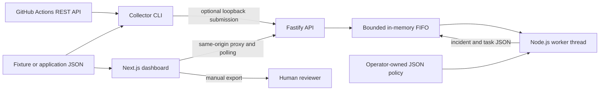

# Architecture

## Evidence and processing

1. The collector pins the latest failed GitHub run attempt reported at collection time and retrieves failed jobs and their failing steps. It uses the GitHub job-log redirect and removes authorization from the signed download request. It can still create incidents from run and job metadata if logs are unavailable. The collector bounds pagination and individual log downloads and selects lines around error markers plus the tail.
2. Fastify validates evidence against the versioned contract, limits request bytes, strips control codes, and redacts known credential patterns before enqueueing. The direct API binds to loopback and rejects foreign Host headers and browser Origin headers. The Next.js proxy allowlists routes and requires the exact local browser origin on writes.
3. The local FIFO uses one active, resource-limited worker thread per submitted job with a ten-second deadline. The worker receives evidence and local policy as data and inherits no environment variables. A failed worker is terminated and the queue moves to the next job. The worker thread is a reliability boundary in the API process.
4. Normalization records a stable incident ID derived from the GitHub repository, commit, run ID, attempt, and job ID. For fixture and application input, it uses the normalized target, timestamp, log excerpts, attempt data, and source. Each submission receives a separate queue job ID. Heuristic categories and suspected paths require review.
5. Task generation supplies a pinned commit, candidate scope, verification requirements, and human review steps. Only trusted local policy can supply approval-eligible paths and runnable reproduction steps. Logs and target names are untrusted. The API and worker never execute submitted content.

## Local API

| Method | Path | Response |
| --- | --- | --- |
| GET | `/health` | 200 with `{"status":"ok"}` |
| POST | `/v1/evidence` | 202 with `jobId` and initial status |
| GET | `/v1/jobs` | 200 with newest-first summaries |
| GET | `/v1/jobs/{id}` | 200 with status and result or failure information |

Body validation uses the [evidence schema](../schemas/evidence.schema.json). Status progresses from `queued` to `running` and then `succeeded` or `failed`. Invalid JSON and evidence yield 400, unsupported media types yield 415, and queue exhaustion yields 503. Results conform to the [incident](../schemas/incident.schema.json) and [task](../schemas/task.schema.json) schemas. The checked-in JSON Schemas are generated from runtime contracts. Repository uniqueness and reserved path checks are also enforced at runtime.

## Trust and operating limits

Use the lab with trusted ReleaseGuard sources and installed dependencies on a disposable CI runner, VM, or development environment. Its temporary directories, loopback services, and scoped environment variables protect against accidental interference. They provide process and data separation. Untrusted repository code requires a separate VM or container with egress restrictions, no host mounts, and no production credentials. The current collector and worker consume JSON only.

Treat log redaction as defense in depth. Patterns cover common credentials, signed URL parameters, authorization values, and private-key blocks. Unknown formats or values without context may survive. Keep artifacts private until reviewed. Logs and policy text can contain instructions aimed at an agent and must remain data or pass a human review, respectively.

The queue and results are volatile and single-instance. The API has no user accounts. Put authenticated access, durable state, retention controls, and repository authorization in place before any shared deployment. GitHub read access stays in the collector. Normal CI runs on disposable GitHub-hosted runners with read-only contents permissions and does not pass the token to test processes.
